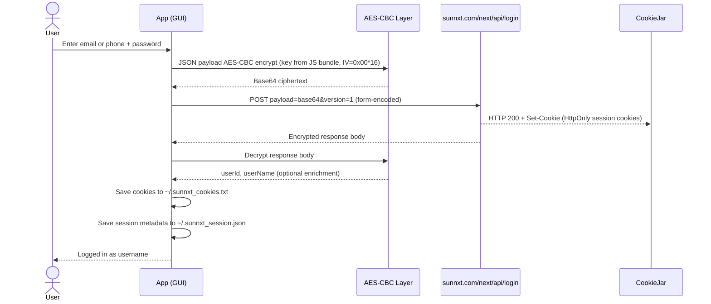
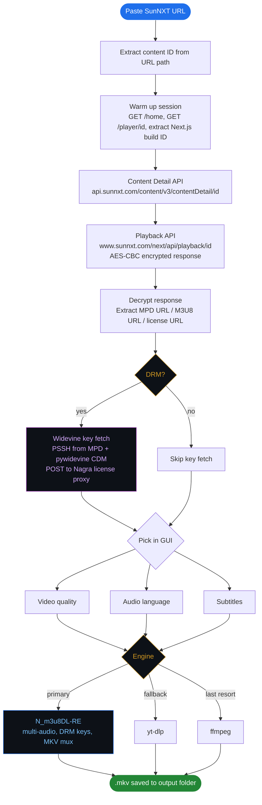
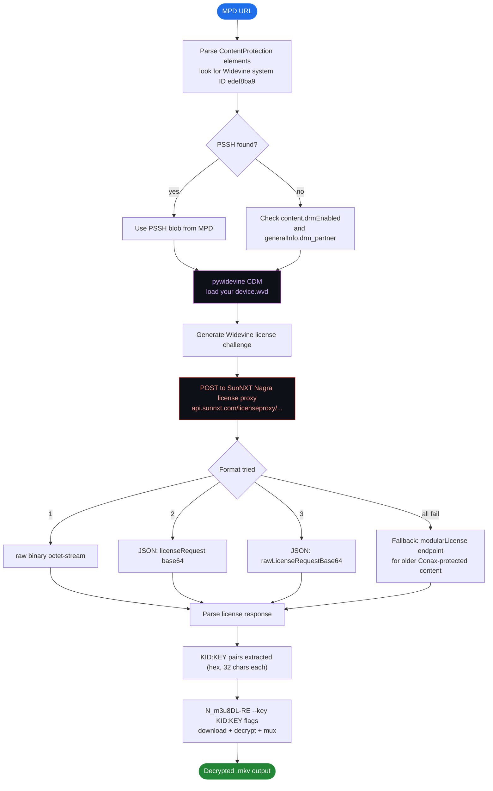
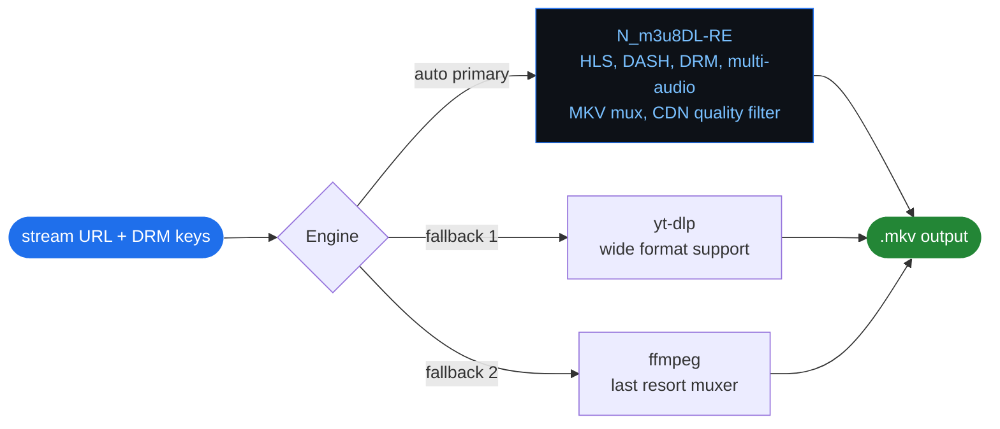
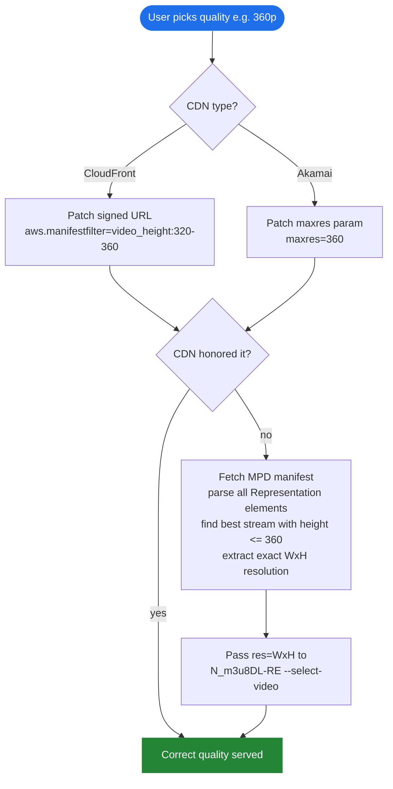
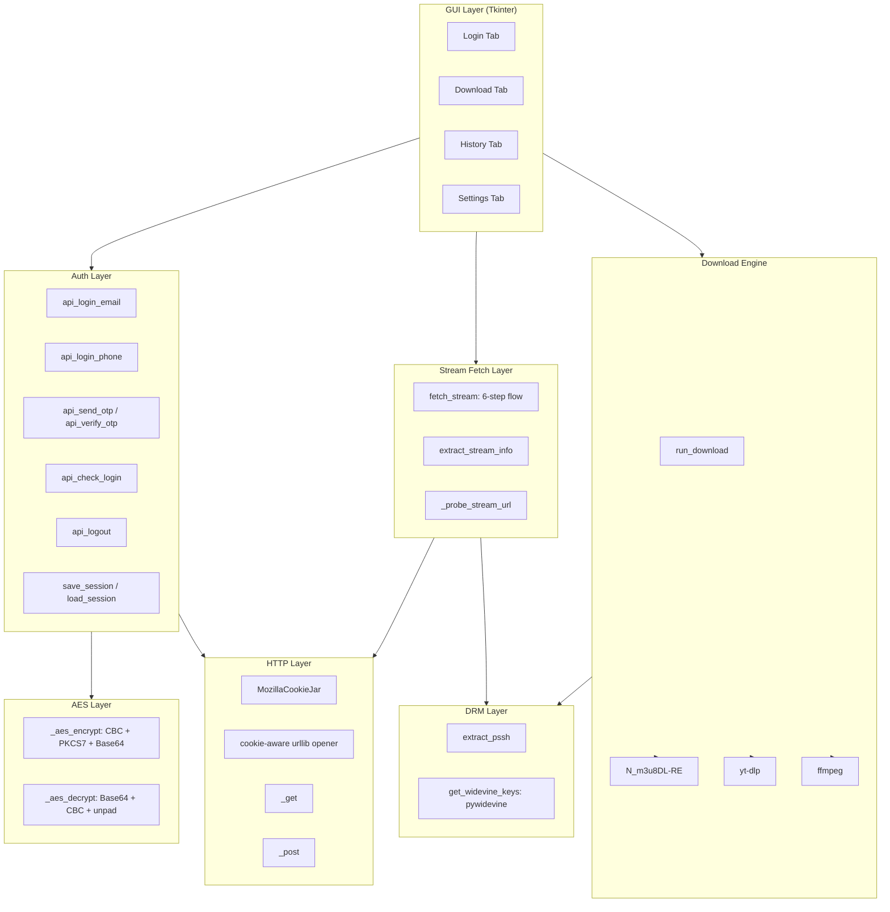

# 🎬 SunNXT Downloader

**A full-featured desktop GUI to download movies, shows, and web series from SunNXT with DRM support, multi-audio, quality selection, and live progress tracking.**

[](https://python.org) [](.) [](LICENSE) [](.) [](.) [](https://github.com/nilaoda/N_m3u8DL-RE)

> **Personal and educational use only. Read the [Disclaimer](#disclaimer) before anything else.**

---

## Table of Contents

- [What is this?](#what-is-this)
- [Features](#features)
- [Requirements](#requirements)
- [Installation](#installation)
- [Usage](#usage)
- [Login Flow](#login-flow)
- [Download Flow](#download-flow)
- [DRM: Widevine and L3 CDM](#drm-widevine-and-l3-cdm)
- [Download Engines](#download-engines)
- [Quality Selection](#quality-selection)
- [Architecture](#architecture)
- [FAQ](#faq)
- [Disclaimer](#disclaimer)

---

## Demo


https://github.com/user-attachments/assets/72a702b3-0bb2-48ca-8b44-d1af889cfb8c


## What is this?

**SunNXT Downloader** is an open-source Python desktop application for downloading content from [SunNXT](https://www.sunnxt.com), one of India's major OTT platforms streaming Tamil, Telugu, Malayalam, Kannada, Hindi, and Bengali movies, TV shows, and web series.

It reverse-engineers the SunNXT browser client's login flow, stream fetch API, and DRM license proxy. No browser extensions, no Chrome DevTools, no manual HAR exports.

**Why one file?** Intentional. No imports to chase, no `src/` folder maze. Clone it, run it, done.

---

## Features

- AES-CBC encrypted login (email or phone number + password)
- Session persistence: cookies saved to disk, auto-restored on next launch
- Paste any SunNXT URL to fetch stream info automatically
- Quality picker: 144p to 1080p or Best available
- Multi-audio: Tamil, Telugu, Malayalam, Kannada, Hindi, Bengali, Marathi, English
- Widevine L3 key extraction using your own `.wvd` CDM device file
- Auto-detects DRM vs plain streams and handles both paths
- Subtitle download: VTT tracks fetched from SunNXT CDN
- N_m3u8DL-RE as primary engine, yt-dlp and ffmpeg as fallbacks
- Real-time progress bar with speed (MB/s) and ETA
- Scrollable download log with Copy and Clear buttons
- Download history across sessions
- Cancel anytime
- Dark GUI, no terminal after setup

---

## Requirements

### Python

Python 3.10 or higher.

### Python packages

```bash
pip install -r requirements.txt
```

`cryptography` is the only required pip package (AES-CBC login encryption).

For DRM content, also install:

```bash
pip install pywidevine
```

### External tools

All three are **mandatory**. Download and set their paths in the **Settings tab** of the GUI before downloading anything.

| Tool | Download |
| --- | --- |
| **N_m3u8DL-RE** | [github.com/nilaoda/N_m3u8DL-RE](https://github.com/nilaoda/N_m3u8DL-RE) |
| **ffmpeg** | [ffmpeg.org](https://www.ffmpeg.org/) |
| **yt-dlp** | [github.com/yt-dlp/yt-dlp](https://github.com/yt-dlp/yt-dlp) |

> Set the full path to each binary in **Settings** inside the app.

### Widevine CDM (`.wvd` file)

Required only for DRM-protected content. Without it the app still works fine for non-DRM streams. See the [DRM section](#drm-widevine-and-l3-cdm) for details.

---

## Installation

```bash
# 1. Clone
git clone https://github.com/arvind88765/sunnxt-downloader.git
cd sunnxt-downloader

# 2. Install Python dependency
pip install -r requirements.txt

# 3. For DRM content
pip install pywidevine

# 4. Place N_m3u8DL-RE and ffmpeg in folder or add to PATH

# 5. Run
python sunnxt_downloader.py
```

---

## Usage

**Login tab**

1. Enter your email or phone number and password.
2. Click Login. Session saved automatically.

**Download tab**

1. Paste a SunNXT movie or show URL.
2. Click **Fetch** to pull stream info.
3. Pick quality and audio language.
4. Set output folder and filename.
5. Click **Download**.
6. Click **Open Folder** at any point to open your output directory.

**Settings tab**: Set paths to external tools and your `.wvd` CDM file here. Save before first download.

---

## Login Flow

SunNXT uses AES-CBC encrypted login payloads over HTTPS with HttpOnly session cookies.



> HttpOnly cookies do not appear in HAR exports. They are captured correctly by Python's `CookieJar` and are the actual auth credential, not the response body.

---

## Download Flow



---

## DRM: Widevine and L3 CDM

### What is DRM?

SunNXT protects most premium content with **Widevine DRM**. Encrypted streams cannot be saved without obtaining decryption keys from SunNXT's license server.

### Key extraction flow



### L3 CDM is required for DRM content

> **You must supply your own Widevine L3 CDM device file (`.wvd`) to download DRM-protected content.**

A CDM (Content Decryption Module) is a device-specific Widevine implementation. L3 is the software-level CDM. SunNXT streams are protected at L3 level, so a software CDM is sufficient.

**The `.wvd` file is not provided.** You must extract it from an Android device or emulator you own.

Guide: [Dumping Your Own L3 CDM with Android Studio](https://forum.videohelp.com/threads/408031-Dumping-Your-own-L3-CDM-with-Android-Studio)

Once you have the file:

1. Open the app, go to Settings.
2. Set the WVD Device File path.
3. Save.

Non-DRM content (some older or free titles) works without any CDM.

### DRM detection signals

The app checks three signals in the content detail API response:

- `results[0].content.drmEnabled = true`
- `generalInfo.drm_partner = "Nagra"` (non-empty string means DRM active)
- `content.isMpegDash = true` (DASH streams on SunNXT are almost always CENC-encrypted)

---

## Download Engines



| Engine | Strengths | When used |
| --- | --- | --- |
| **N_m3u8DL-RE** | DRM keys, multi-audio, MKV mux, CDN quality filter | Always first |
| **yt-dlp** | Wide format support | N_m3u8DL-RE not found or fails |
| **ffmpeg** | Reliable muxer | Both above fail |

On a 90 Mbps connection, a 1-hour episode takes roughly 20 seconds with N_m3u8DL-RE vs 3+ minutes with ffmpeg alone.

---

## Quality Selection

Quality selection works at two levels:



---

## Architecture



---

## FAQ

**Q: Does this work with a free SunNXT account?** Downloads whatever your subscription allows. Premium content requires a paid plan.

**Q: N_m3u8DL-RE says "Cannot create a file when that file already exists"?** Delete the existing `.mkv` in your output folder. N_m3u8DL-RE does not overwrite existing files.

**Q: "No PSSH found" in log. DRM content not downloading?** Make sure you have set a valid `.wvd` CDM file in Settings. Without it, Widevine key extraction will not run.

**Q: Where do I get a `.wvd` CDM file?** Not provided here. Extract it from an Android device or emulator you own. See this guide: [Dumping Your Own L3 CDM with Android Studio](https://forum.videohelp.com/threads/408031-Dumping-Your-own-L3-CDM-with-Android-Studio)

**Q: Some content downloads 1080p even when 360p is selected?** CDN quality filtering is not always honored server-side. The app tries both CDN URL patching and MPD-level resolution selection. If both fail, it is a CDN-side behavior outside the app's control.

**Q: Session expires every restart?** SunNXT sessions last approximately 30 days. The app auto-restores from `~/.sunnxt_cookies.txt`. If expired, log in again.

**Q: Can I download subtitles?** Yes. When available, SunNXT returns VTT subtitle links in the content detail API. The app detects and passes them to N_m3u8DL-RE for muxing into the output MKV.

**Q: Which engine is best?** N_m3u8DL-RE. It handles DRM, multi-audio, quality filters, and MKV mux natively. Use yt-dlp and ffmpeg only as fallbacks.

---

## Notes

- Session cookies are stored in plain text at `~/.sunnxt_cookies.txt`. Keep this file private.
- The `.wvd` CDM file is sensitive. Do not share it.
- Downloads are saved as `.mkv` containers by default.
- SunNXT streams use **CloudFront** and **Akamai** CDNs with signed URLs. Links expire; do not reuse them.
- DRM keys are content-specific and session-specific. They are only valid during your active download session.

---

## Disclaimer

This tool is for personal and educational use only.

- You need an active SunNXT subscription to use this.
- Downloading DRM-protected content may violate SunNXT's Terms of Service.
- Do not distribute anything you download.
- The `.wvd` Widevine device file is not provided and must be sourced by you.
- This project is not affiliated with or endorsed by SunNXT or Sun Group.
- The authors take no responsibility for how this tool is used.

---

## Built by

A lazy person with zero skills......

---

## Contributing

PRs welcome. Keep it clean, no bloat. Open an issue before big refactors.

---

## License

MIT. See [LICENSE](LICENSE)

---

**Keywords:** `sunnxt downloader` `download sunnxt movies` `sunnxt ott downloader` `south indian ott downloader` `tamil movie downloader` `telugu movie downloader` `sunnxt python gui` `widevine l3 drm downloader` `N_m3u8DL-RE sunnxt` `pywidevine sunnxt` `HLS DASH downloader python` `sunnxt drm` `sunnxt stream download`
